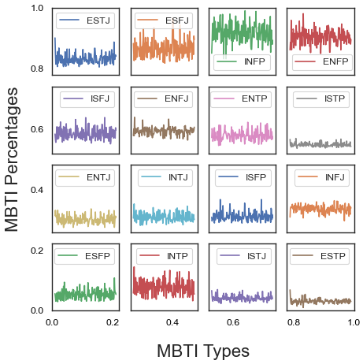
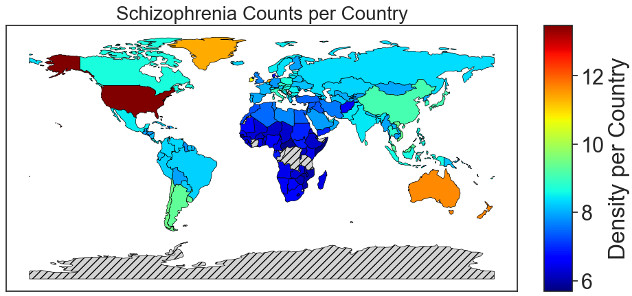
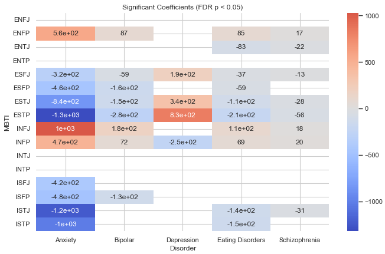

# Myers Briggs Type Indicator Data Project
[Link to Data](https://github.com/BellaIngenue/Typology-And-Mental-Health)

## Overview

Throughout the past decade, Myers-Briggs Type Indicator (MBTI) has been notorious for personality assessments and self-discovery. We wanted to look further into this topic, and the connection between MBTI and Mental Health Disorders. MBTI is hypothesized to have types that are more correlated with different disorders. That is what we will look further into. Although they are known as pseudosciences, these forms of self-acknowledgement are great for human growth and development.

## Pictures of Data Analytics

